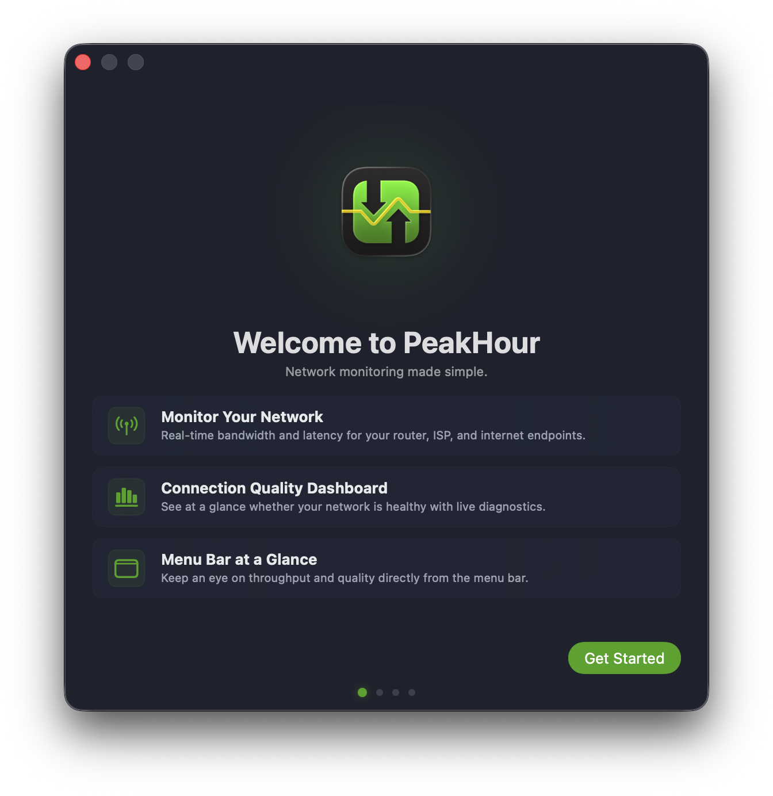
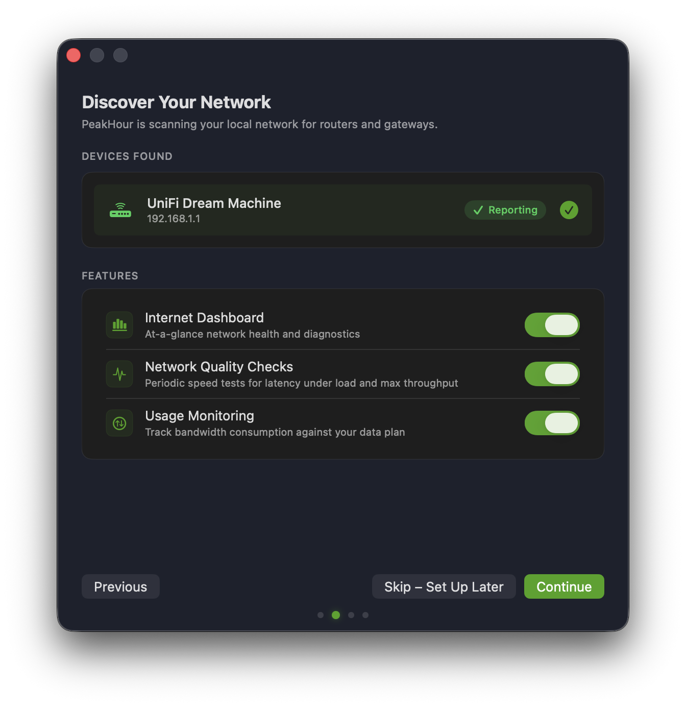
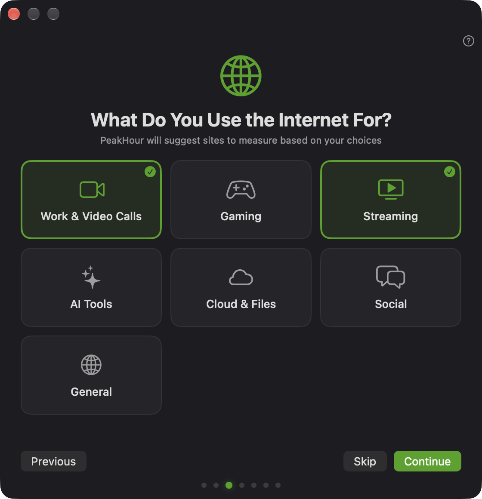
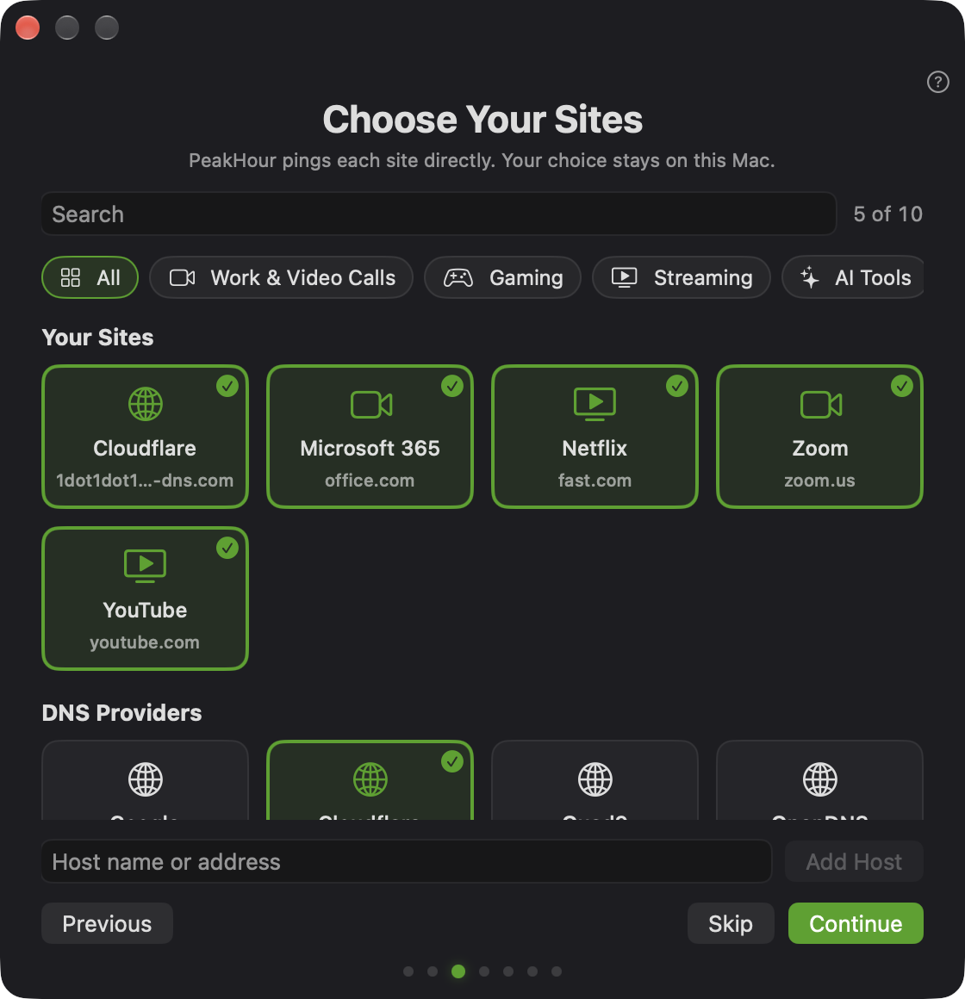
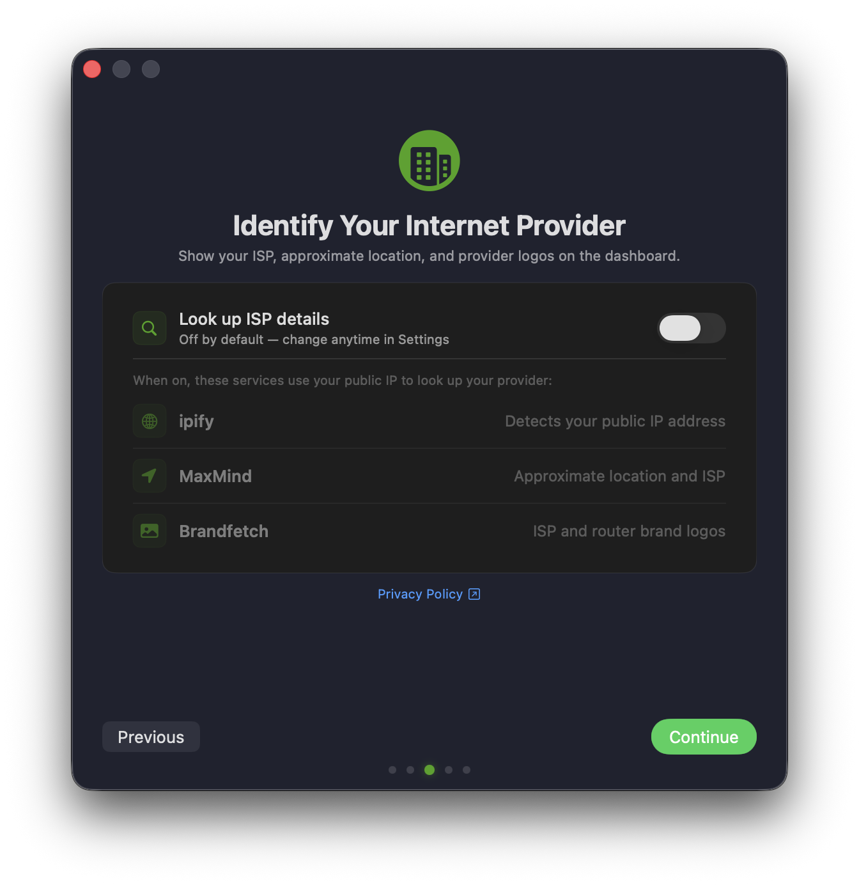
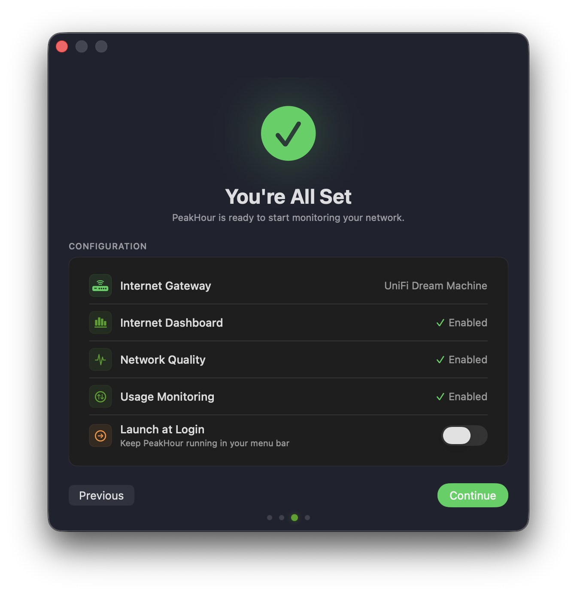
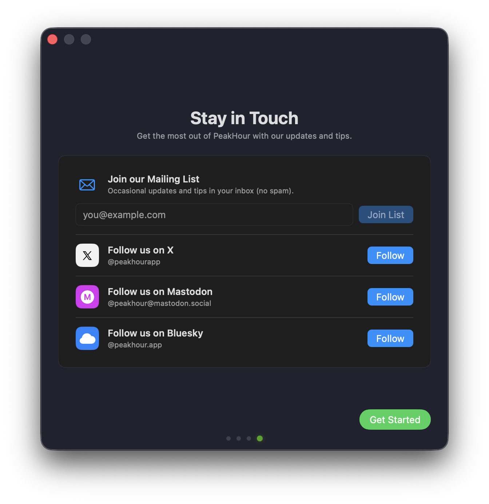
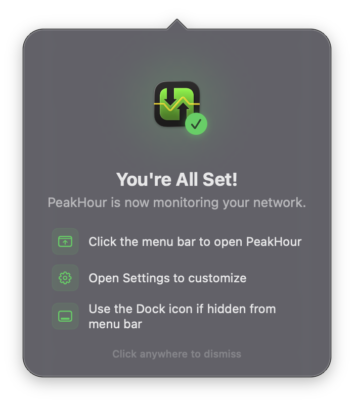
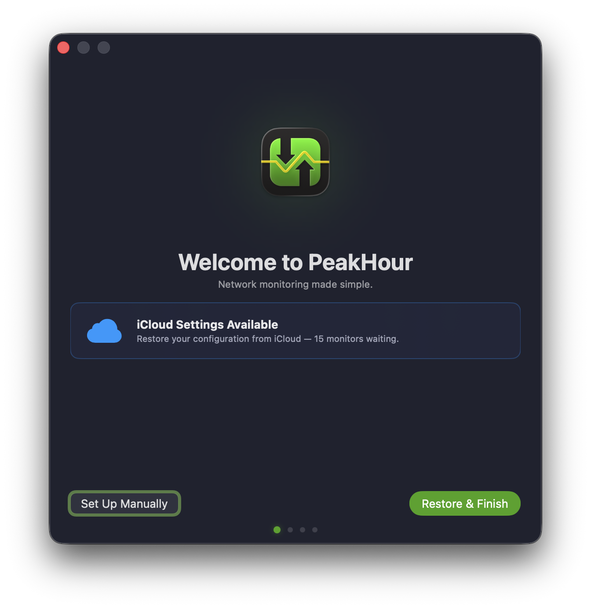

## Prerequisites

Before you set up PeakHour on your Mac:

- Check that your system meets the [Requirements](/user-guide/requirements/).
- **Enable UPnP on your Internet router.** PeakHour uses UPnP to discover your router automatically during setup. Most routers ship with UPnP on by default — if yours doesn't, look for an option labelled **UPnP** or **Universal Plug & Play** in your router's admin interface and turn it on before launching PeakHour. See [UPnP Troubleshooting](/troubleshooting/upnp/) if your router still isn't discovered.

## Getting Started

When you launch PeakHour for the first time, the First Time Setup Assistant will appear to guide you through the setup process.

Setup takes a few short steps:

1. **Welcome** — a quick overview of what PeakHour does.
2. **Discover Your Network** — PeakHour finds your router and lets you pick which features to enable.
3. **Choose your sites** — tell PeakHour what you use the Internet for, and choose the sites it measures. This step shows only with the Internet Dashboard on.
4. **Identify Your Internet Provider** — choose whether PeakHour looks up your ISP details (off by default).
5. **Smarter AI Advisor** — choose where the AI Advisor writes its explanations. This step shows only on a Mac that can use Private Cloud Compute.
6. **You're All Set** — confirm your configuration before finishing.
7. **Stay in Touch** — optional: subscribe to updates or follow PeakHour on social.

If you've previously used PeakHour on another Mac with iCloud sync enabled, see [Restoring from iCloud](#restoring-from-icloud) — setup can apply those settings in a single click.

## 1. Welcome

The Welcome screen introduces the three main views you'll work with in PeakHour: bandwidth monitoring for your router, ISP and internet endpoints; the Internet Dashboard; and the menu bar widget. Click **Get Started** to continue.

## 2. Discover Your Network

PeakHour scans your local network for routers and gateways that support UPnP. If a device is found and is reporting usage correctly, it appears under **Devices Found** with a **Reporting** badge. If your router doesn't appear, see [Can't find your Internet router?](#cant-find-your-internet-router) below.

Below the devices list, choose which features to enable:

| Feature | Description |
|---------|-------------|
| **Internet Dashboard & AI Advisor** | An at-a-glance view of your network's health and live diagnostics. |
| **Speed Tests** | Periodic speed tests for your speed and your latency under load. See [Speed Test](/user-guide/settings/dashboard/#speed-test). |
| **Usage Monitoring** | Tracks bandwidth consumption against your data plan. |

All three are enabled by default. Click **Continue** to apply them, or **Skip – Set Up Later** to configure things manually from [Settings](/user-guide/settings/) later.

### Can't find your Internet router?

If the **Devices Found** list is empty or your router isn't appearing:

- Make sure UPnP is enabled on your router — see [Prerequisites](#prerequisites). Look for an option labelled **UPnP** or **Universal Plug & Play** in your router's admin interface.
- Restart both your router and PeakHour after enabling UPnP so PeakHour re-runs discovery.
- Some routers don't fully implement the UPnP spec, or implement it poorly. PeakHour validates what your router reports and marks it as **Reporting** when the data looks valid.
- For deeper diagnostics, see [UPnP Troubleshooting](/troubleshooting/upnp/).

**Using SNMP instead?** PeakHour can monitor SNMP-enabled routers and other devices, but SNMP doesn't support auto-discovery — SNMP devices won't appear in First Time Setup. Skip the Discover step and add them after setup from [Settings](/user-guide/settings/).

## 3. Choose your sites

PeakHour measures the Internet with a list of [Internet sites](/user-guide/main-view/internet-sites/). This step helps you choose sites that you use. It has two pages.

**What Do You Use the Internet For?** — click each card that fits: **Work & Video Calls**, **Gaming**, **Streaming**, **AI Tools**, **Cloud & Files**, **Social** or **General**. You can choose more than one, or none. Click **Continue**.

**Choose Your Sites** — PeakHour suggests five sites from your choices, with **Cloudflare** first. With no card chosen, it suggests **Cloudflare** only. The suggested sites show selected under **Your Sites**. Click a site to add it or remove it, up to 10 sites. To add a site that isn't in the list, type its host name or address in **Host name or address**, and click **Add Host**. Click **Continue**.

*PeakHour pings each site directly. Your choice stays on this Mac.*

Click **Skip** to keep the default sites: Google, Cloudflare and Netflix. You can change the sites at any time in [Settings → Dashboard → Internet Sites](/user-guide/settings/dashboard/#internet-sites).

## 4. Identify Your Internet Provider

PeakHour can enrich your [Internet Dashboard](/user-guide/main-view/internet-dashboard/) with your provider's name, approximate location, and ISP and router brand logos. It also lets the [PeakHour Advisor](/user-guide/advisor/) show the route to each site. Enabling this lookup is optional.

**Look up ISP details is off by default.** Leave the toggle off to keep PeakHour from contacting any third-party services, or turn it on to identify your provider. You can change this later under [Settings → Dashboard](/user-guide/settings/dashboard/#isp-information).

When enabled, PeakHour uses these services to look up your provider and the route to each site:

| Service | What it provides |
|---------|------------------|
| **ipify** | Detects your public IP address. |
| **MaxMind**, through PeakHour's own lookup service | The network name and approximate location of your IP address, the sites you monitor, and the routers on the way. |
| **RIPE NCC** | The network that a router belongs to, when MaxMind can't name it. |
| **PeeringDB** | A network's web domain, to find its logo. |
| **Brandfetch** | ISP, router and network logos. |

:::note
These services receive internet addresses, network numbers and web domains — not your name, your Mac's name or your Wi-Fi name. For exactly what each one receives, see [ISP Information](/user-guide/settings/isp-information/#what-goes-where).
:::

Click **Learn More** to open the [ISP Information](/user-guide/settings/isp-information/) page, or **Privacy Policy** to read exactly how this information is used, then click **Continue**.

## 5. Smarter AI Advisor

On a Mac with macOS 27 and Apple Intelligence, setup asks where the AI Advisor writes its explanations. Turn on **Private Cloud Compute** to let a larger Apple model write them, or leave it off to keep the AI Advisor on your Mac. You can change it later in [Settings → Dashboard → AI Advisor](/user-guide/settings/dashboard/#ai-advisor). See [Private Cloud Compute](/user-guide/advisor/ask/#private-cloud-compute).

## 6. You're All Set

Review the configuration PeakHour is about to apply:

- **Internet Gateway** — the router PeakHour found in the previous step.
- **Features** — the features you enabled: **Internet Dashboard**, **Speed Test**, **ISP Information** and **Usage Monitoring**.
- **Launch at Login** — toggle on if you'd like PeakHour to start automatically when you log in to your Mac.

Click **Continue** to apply your configuration.

## 7. Stay in Touch

The final step is optional. Join the mailing list for occasional updates and tips (no spam), or follow PeakHour on [X](https://x.com/peakhourapp), [Mastodon](https://mastodon.social/@peakhour) or [Bluesky](https://bsky.app/profile/peakhour.app).

Click **Get Started** to finish setup and start monitoring. 🎉

## After Setup

Once setup completes, PeakHour starts monitoring in the background and a short popover appears from its menu bar icon confirming everything is up and running. Click anywhere to dismiss it.

### Can't see PeakHour in your menu bar?

PeakHour needs some horizontal space in the menu bar to display its monitors — especially on Macs with the notch (MacBook Pro 14"/16"), where usable menu-bar width is limited. If PeakHour's icons aren't visible, macOS has likely hidden them behind the notch or another app's menu-bar item.

To make room:

- Open **PeakHour Settings → [Menu Bar](/user-guide/settings/menu-bar/)** and disable any Menu Bar Items you don't need by dragging them from **Active Items** back to **Available Items**.
- Or remove other apps' menu-bar icons from **System Settings → Control Center**, or use a menu-bar manager like Bartender or Ice to hide them.

If you can't see PeakHour at all, click its icon in the Dock to open the main window — monitoring continues regardless of whether the menu bar item is visible.

## Restoring from iCloud

If you've previously set up PeakHour on another Mac signed in to the same Apple Account, the Welcome screen detects your saved settings and offers to restore them. Click **Restore & Finish** to apply your existing configuration in a single step, or **Set Up Manually** to go through the regular steps.

## Next Steps

Now that PeakHour is running, here are some additional resources to help you use PeakHour:

  - To open PeakHour and view your monitors, click the menu bar area or the Dock icon to open PeakHour. For detailed instructions and explanation of the interface, visit [Main View](/user-guide/main-view/).

  - To read more about PeakHour's many options, visit [Settings](/user-guide/settings/).
