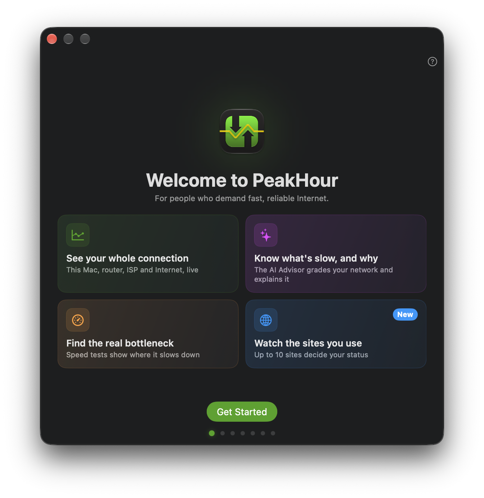
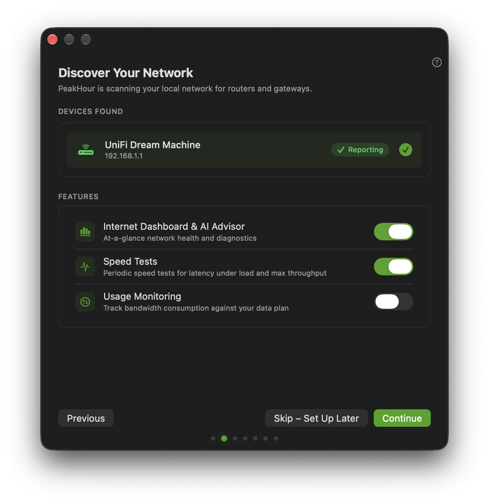
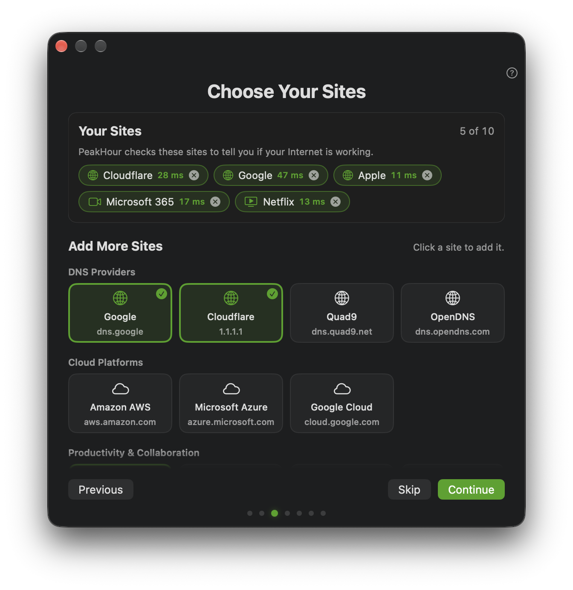
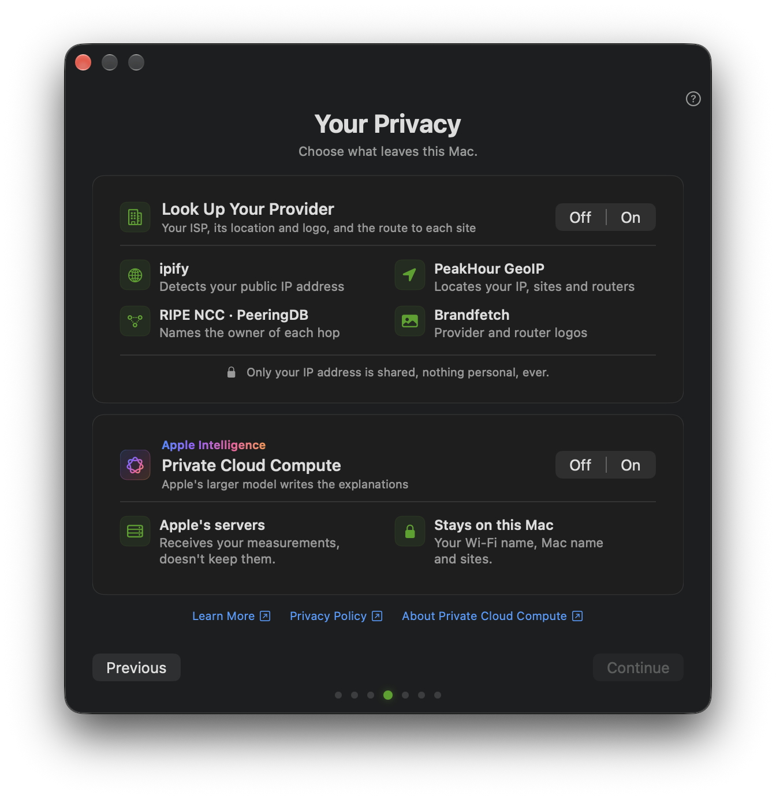
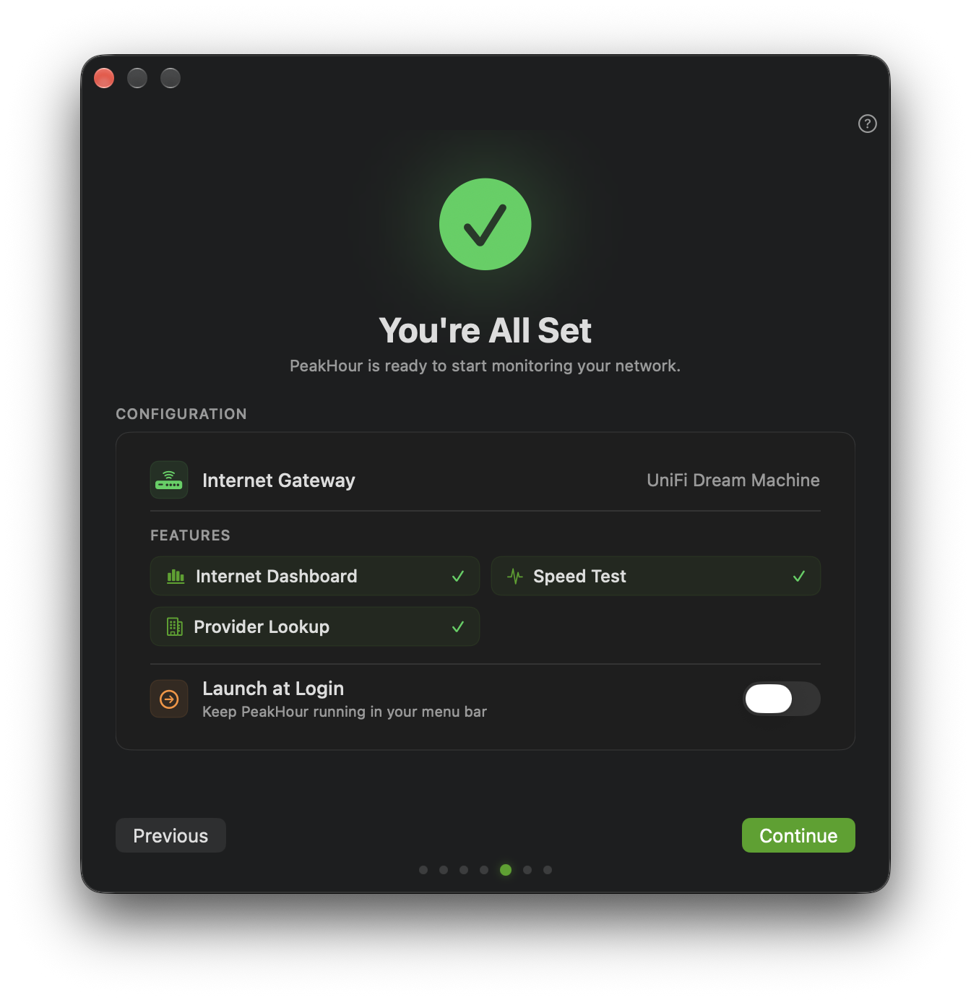
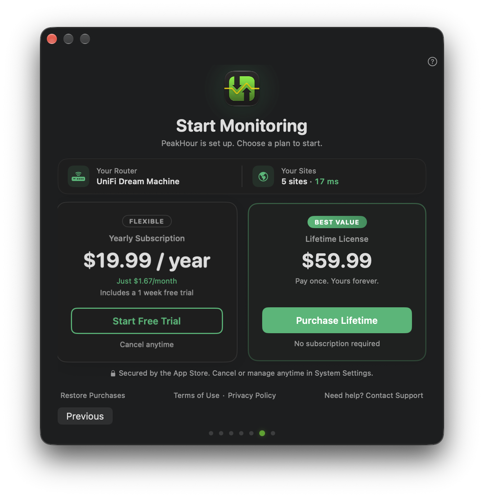
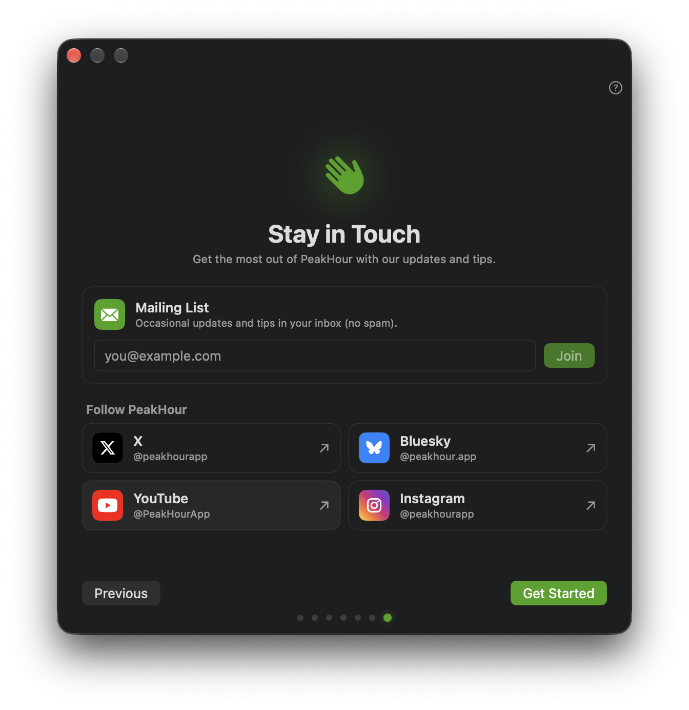
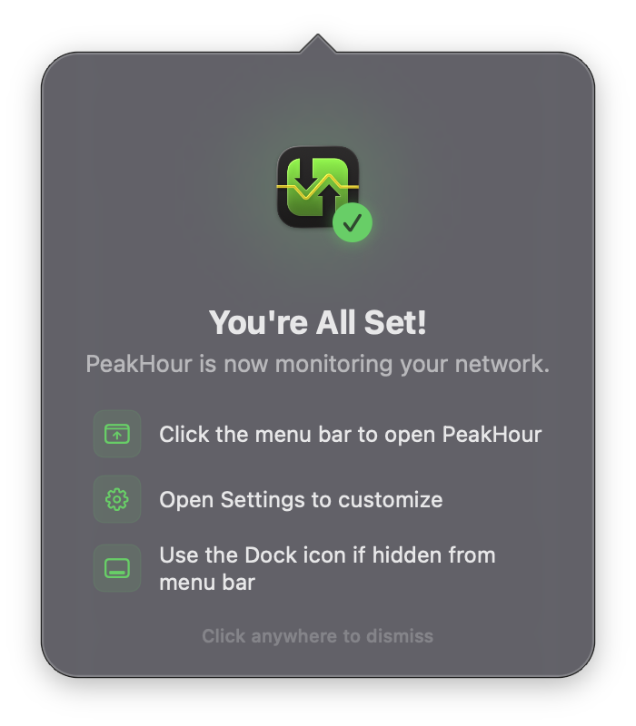
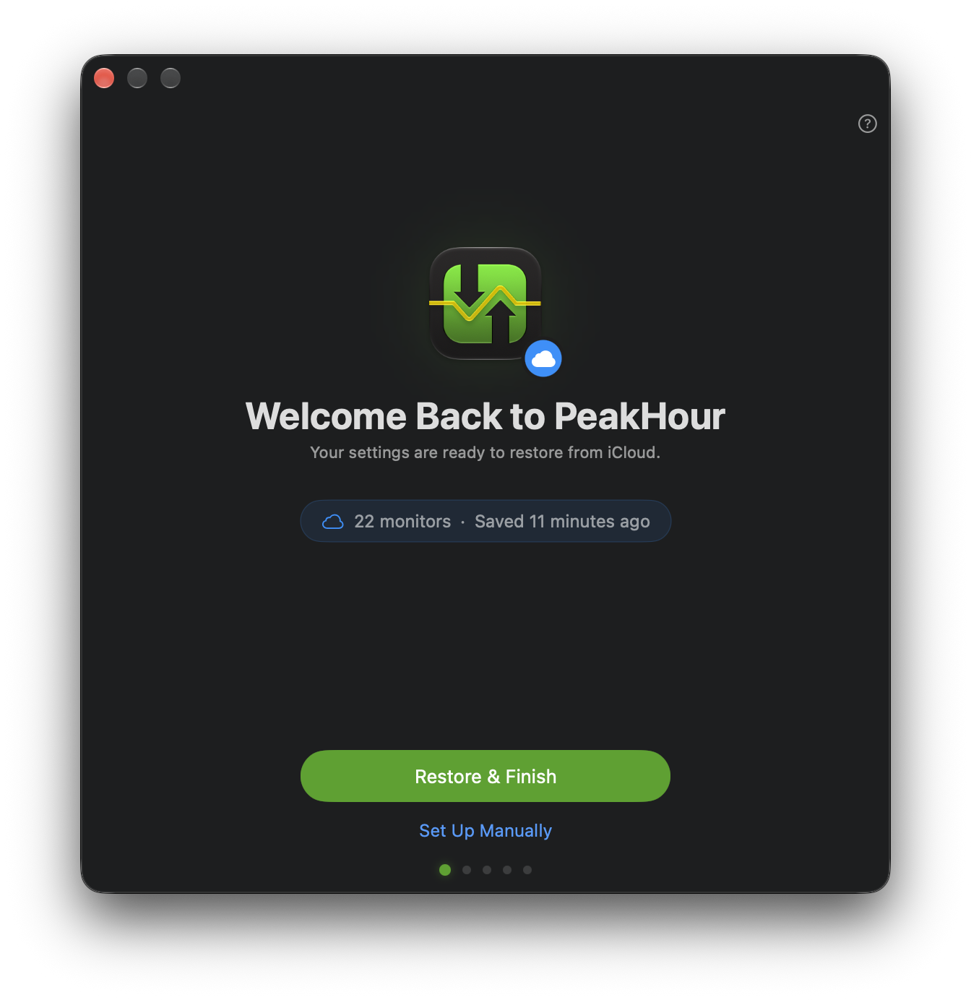

## Prerequisites

Before you set up PeakHour on your Mac:

- Check that your system meets the [Requirements](/user-guide/requirements/).
- **Enable UPnP on your Internet router.** PeakHour uses UPnP to discover your router automatically during setup. Most routers ship with UPnP on by default — if yours doesn't, look for an option labelled **UPnP** or **Universal Plug & Play** in your router's admin interface and turn it on before launching PeakHour. See [UPnP Troubleshooting](/troubleshooting/upnp/) if your router still isn't discovered.

## Getting Started

When you launch PeakHour for the first time, the First Time Setup Assistant appears and guides you through the setup.

The setup has these steps:

1. **Welcome**: an overview of what PeakHour does.
2. **Discover Your Network**: PeakHour finds your router, and you choose which features to enable.
3. **Choose Your Sites**: choose the sites that PeakHour checks to tell you if your Internet is working.
4. **Your Privacy**: choose what leaves your Mac.
5. **You're All Set**: check your configuration.
6. **Start Monitoring**: choose a plan. Skip this step if you already have a license.
7. **Stay in Touch**: optional. Join the mailing list or follow PeakHour.

You can try the setup before you pay. PeakHour starts to monitor only after you start a free trial, buy a license or restore a purchase.

If you used PeakHour on another Mac with iCloud sync on, see [Restoring from iCloud](#restoring-from-icloud). If you are moving from PeakHour 4, see [Upgrading from PeakHour 4](/troubleshooting/faq/purchasing-licensing/upgrade-from-peakhour-4/).

## 1. Welcome

The Welcome screen shows the main features of PeakHour: live monitors for this Mac, your router, your ISP and the Internet; the sites that set your Internet status; Speed Tests; and the AI Advisor. Click **Get Started** to continue.

## 2. Discover Your Network

PeakHour scans your local network for routers and gateways that support UPnP. When it finds a router that reports usage correctly, the router shows with a **Reporting** badge.

If PeakHour finds no router, the step shows **No routers detected**, your Wi-Fi and gateway addresses, and if the Internet is reachable. PeakHour can still monitor latency, quality and throughput. Click **Retry Scan** to scan again, or **How to turn on UPnP** to open [Turn on UPnP](/troubleshooting/upnp/turn-on-upnp/). See also [Can't find your Internet router?](#cant-find-your-internet-router) below.

Below the network status, choose which features to enable:

| Feature | Description |
|---------|-------------|
| **Internet Dashboard & AI Advisor** | An at-a-glance view of your network's health and live diagnostics. On by default. |
| **Speed Tests** | Periodic speed tests for your speed and your latency under load. See [Speed Test](/user-guide/settings/dashboard/#speed-test). On by default. |
| **Usage Monitoring** | Tracks bandwidth consumption against your data plan. Off by default. |

Click **Continue**, or **Skip – Set Up Later** to configure PeakHour from [Settings](/user-guide/settings/) later.

### Can't find your Internet router?

If PeakHour finds no router:

- Make sure UPnP is on in your router. See [Turn on UPnP](/troubleshooting/upnp/turn-on-upnp/).
- Click **Retry Scan** after you turn on UPnP.
- Some routers implement UPnP poorly. PeakHour checks what your router reports, and shows **Reporting** only when the data is valid.
- For more help, see [UPnP Troubleshooting](/troubleshooting/upnp/).

**Using SNMP instead?** PeakHour can monitor SNMP routers and other devices, but SNMP has no auto-discovery, so SNMP devices do not show in the setup. Add them after the setup from [Settings](/user-guide/settings/).

## 3. Choose Your Sites

PeakHour checks a list of sites to tell you if your Internet is working. First, choose what you use the Internet for, for example work and video calls, gaming or streaming. PeakHour then suggests sites for your choices. If you choose nothing, PeakHour suggests five everyday sites.

On **Choose Your Sites**, the **Your Sites** card at the top shows the sites that PeakHour will check, up to 10. Each site shows its current response time. Click the × on a site to remove it.

Below **Add More Sites**, click a site to add it. To add a site that is not in the list, click **Add a Site** at the end of the list, then type a host name or IP address.

You can change your sites later in [Settings → Dashboard](/user-guide/settings/dashboard/).

## 4. Your Privacy

This step asks you to choose what leaves your Mac. Neither option is set until you choose **Off** or **On**. **Continue** is available when you have made each choice. You can change each choice later.

### Look Up Your Provider

Provider Lookup adds your provider's name, its approximate location and logo to the [Internet Dashboard](/user-guide/main-view/internet-dashboard/). It also lets the [PeakHour Advisor](/user-guide/advisor/) show the route to each site.

When it is on, PeakHour uses these services:

| Service | What it provides |
|---------|------------------|
| **ipify** | Detects your public IP address. |
| **MaxMind**, through PeakHour's own lookup service | The network name and approximate location of your IP address, the sites you monitor, and the routers on the way. |
| **RIPE NCC** | The network that a router belongs to, when MaxMind can't name it. |
| **PeeringDB** | A network's web domain, to find its logo. |
| **Brandfetch** | ISP, router and network logos. |

When it is off, nothing is sent to these services. The dashboard shows "Your ISP" with no provider details, and the Advisor shows no routes or site map.

:::note
These services receive internet addresses, network numbers and web domains. They do not receive your name, your Mac's name or your Wi-Fi name. For what each service receives, see [Provider Lookup](/user-guide/settings/isp-information/#what-goes-where).
:::

To change this later, use **Look Up Provider Details** in [Settings → Dashboard](/user-guide/settings/dashboard/#provider-lookup).

### Private Cloud Compute

This card shows only on Macs that support Apple Intelligence. When **Private Cloud Compute** is on, Apple's larger model writes the AI Advisor's explanations. Your measurements go to Apple's servers, which do not keep them. Your Wi-Fi name, Mac name and sites stay on your Mac.

When it is off, **On-Device Models** on your Mac write the explanations. Nothing is sent, and the Advisor works offline, but the explanations are less accurate. See [PeakHour Advisor](/user-guide/advisor/).

## 5. You're All Set

Check the configuration that PeakHour will apply:

- **Internet Gateway**: the router that PeakHour found.
- **Features**: the features that you enabled.
- **Launch at Login**: turn on to start PeakHour when you log in to your Mac.

Click **Continue**.

## 6. Start Monitoring

If you do not have a license yet, this step shows your router and your sites, with their response time, and the plans:

- **Yearly Subscription**: includes a one-week free trial. Click **Start Free Trial**.
- **Lifetime License**: pay once. Click **Purchase Lifetime**.

If you already bought PeakHour, click **Restore Purchases**. PeakHour starts to monitor when the trial, the purchase or the restore is complete.

If you close the setup window before you choose a plan, PeakHour quits. The next time you open PeakHour, the setup starts again.

## 7. Stay in Touch

This step is optional. Type your email address and click **Join** to get occasional updates and tips (no spam). Or follow PeakHour on X, Bluesky, YouTube or Instagram.

Click **Get Started** to finish the setup.

## After Setup

Once setup completes, PeakHour starts monitoring in the background and a short popover appears from its menu bar icon confirming everything is up and running. Click anywhere to dismiss it.

### Can't see PeakHour in your menu bar?

PeakHour needs some horizontal space in the menu bar to display its monitors — especially on Macs with the notch (MacBook Pro 14"/16"), where usable menu-bar width is limited. If PeakHour's icons aren't visible, macOS has likely hidden them behind the notch or another app's menu-bar item.

To make room:

- Open **PeakHour Settings → [Menu Bar](/user-guide/settings/menu-bar/)** and disable any Menu Bar Items you don't need by dragging them from **Active Items** back to **Available Items**.
- Or remove other apps' menu-bar icons from **System Settings → Control Center**, or use a menu-bar manager like Bartender or Ice to hide them.

If you can't see PeakHour at all, click its icon in the Dock to open the main window — monitoring continues regardless of whether the menu bar item is visible.

## Restoring from iCloud

If you set up PeakHour on another Mac signed in to the same Apple Account, the Welcome screen shows **Welcome Back to PeakHour** with the number of monitors in your saved settings.

- Click **Restore & Finish** to apply your settings. **You're All Set** then shows the number of monitors that PeakHour restores. If you do not have a license on this Mac, **Start Monitoring** comes next, and it is the last step.
- Click **Set Up Manually** to go through the setup steps.

After an iCloud restore, the setup does not show **Stay in Touch**.

## Next Steps

Now that PeakHour is running, here are some additional resources to help you use PeakHour:

  - To open PeakHour and view your monitors, click the menu bar area or the Dock icon to open PeakHour. For detailed instructions and explanation of the interface, visit [Main View](/user-guide/main-view/).

  - To read more about PeakHour's many options, visit [Settings](/user-guide/settings/).
