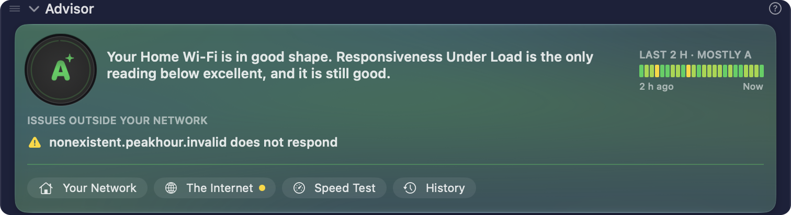

The **Advisor** section of the [main window](/user-guide/main-view/) is a short summary of the [PeakHour Advisor](/user-guide/advisor/). It shows how your connection is, without a second window. It sits under the [Internet Dashboard](/user-guide/main-view/internet-dashboard/) by default.

The section has the look of the [Advisor window](/user-guide/advisor/): a glass card tinted in the colour of your grade. From top to bottom, it shows:

| Element | Description |
|---------|-------------|
| **Grade** | Your [grade](/user-guide/advisor/grade/), from **A+** down to **F**. A number on its rim shows how many issues hold the grade back. When the grade changes, it pulses once. Click the grade to open the Advisor window. |
| **Summary** | Your connection in one to three lines, with the name of your connection in bold, for example **Home Wi-Fi** or **Ethernet**. |
| **Grade timeline** | Your grade over the last 2 hours. See [The grade timeline](#the-grade-timeline). |
| **Issues identified** | Up to three issues that hold the grade back, the worst first, each with where the problem is, for example **On this Mac's Wi-Fi**. A grade of **A** or **A+** has no issues. |
| **Issues outside your network** | When some of your [Internet sites](/user-guide/main-view/internet-sites/) don't respond but your connection works, a row says so, for example **Netflix does not respond** or **2 sites do not respond**, with the names of the sites. It doesn't change the grade: the problem is on the route to those sites, or at the sites. |
| **Links** | **Your Network**, **The Internet**, **Speed Test** and **History** open the Advisor window at that page. **The Internet** has an orange dot while a site doesn't respond. In a narrow window, the links show only their symbols. |

The **?** in the section header opens [How the grade works](/user-guide/advisor/grade/).

## The grade timeline

The timeline has 24 blocks, one for each 5 minutes of the last 2 hours, from **2 h ago** to **Now**. Each block has the colour of the worst grade in its 5 minutes, so a short problem stays visible. A grey block means no connection. A faint block means no data, for example while PeakHour was not running.

The caption above it gives the most common grade, for example **Last 2 h · mostly B**. Hover over a block to see its time and grade. Click it to open the Advisor's [History](/user-guide/advisor/history/) page.

The timeline shows when the window is wide enough, and after PeakHour has its first grade.

## One grade on screen

PeakHour shows your grade in one place at a time. While the Advisor section is expanded, the grade is in the section, and the dashboard shows no grade. When you collapse or hide the Advisor section, the grade goes back to the dashboard.

When the section is collapsed, its header shows a one-line summary: the status, for example **Good**, or the top issue, and a small grade timeline. Hover over the small timeline to see the most common grade. The header shows the grade too, but only while the dashboard is hidden or collapsed.

## While the Advisor waits

The section shows a status in place of the summary, with no issues:

- **Analyzing…** — PeakHour gathers its first measurements, for example after a launch or after your Mac wakes.
- **Waiting for speed test** — a speed test runs. The grade comes back when the test ends.
- **Offline** — this Mac has no network connection.

## With the AI Advisor off

With [AI Advisor](/user-guide/settings/dashboard/#ai-advisor) off, the section has no grade, summary, timeline or issues. It still shows the links to the Advisor window.

## Requirements

The Advisor section needs macOS 26 or later, and the [Internet Dashboard](/user-guide/settings/dashboard/) turned on. On macOS 14 and 15, the section doesn't show, and it isn't in the list of sections.

To move the section, drag its header. To hide it, use **Show Sections** in the footer, or right-click its header. See [Customize the main window](/user-guide/main-view/#customize-the-main-window).
