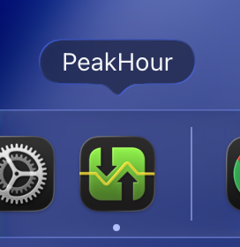
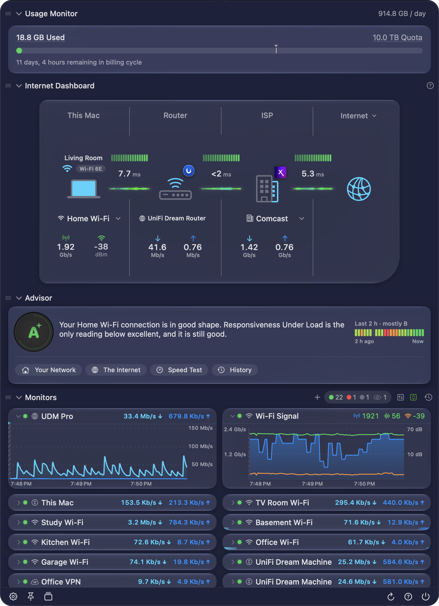
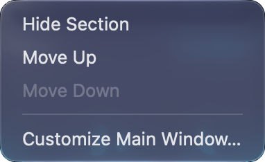

## Opening the main window

PeakHour's main window is your primary view into network activity. There are two ways to open it:

**From the menu bar.** Click the PeakHour menu bar item. The exact information shown there depends on which Menu Bar Items you have configured in [Settings → Menu Bar](/user-guide/settings/menu-bar/).

**From the Dock.** Click PeakHour's Dock icon if it's enabled. The Dock icon is on by default — toggle it from [Settings → Dashboard](/user-guide/settings/dashboard/).

## Overview

The main window holds up to four sections, one under the other, in one scroll view:

- **[Usage Monitor](/user-guide/settings/usage/)** — tracks data used and remaining against your billing cycle quota. It shows only when Usage Monitoring is on.
- **[Internet Dashboard](/user-guide/main-view/internet-dashboard/)** — a single-view summary of your connection's health from your Mac out to the internet.
- **[Advisor](/user-guide/main-view/advisor-section/)** — your grade, what holds it back, and your last speed test, with links to the PeakHour Advisor. It needs macOS 26 or later.
- **[Monitors](/user-guide/main-view/monitors/)** — the graphs of all your monitors: [bandwidth](/user-guide/main-view/bandwidth-monitors/), [latency](/user-guide/main-view/latency-monitors/) and [Wi-Fi Signal](/user-guide/main-view/wifi-signal-monitor/).

The window grows with its sections, up to the height of your screen. Then it scrolls. The footer stays in place while the sections scroll, and so does the title bar of a pinned window.

Click the title of a section to collapse it or expand it. PeakHour keeps the state of each section.

## Customize the main window

You can hide any section, and put the sections in any order. There are two ways.

### From a section header

Right-click the header of a section:

| Item | Description |
|------|-------------|
| **Hide Section** | Removes the section from the main window. |
| **Move Up**, **Move Down** | Moves the section one place. They are grey for the first and the last section. |
| **Show Section** | A list of the hidden sections. Choose one to show it under this section. |
| **Customize Main Window…** | Opens [Settings → Display → Main Window](/user-guide/settings/display/#main-window). |

### In Settings

Open [Settings → Display → Main Window](/user-guide/settings/display/#main-window). Select or clear the checkbox of a section to show or hide it. Drag a section to move it. The main window changes at once.

When you hide every section, the main window reads **All Sections Hidden**. Click **Customize…** to show them again.

Your layout syncs to your other Macs with [iCloud](/user-guide/settings/icloud/).

:::note
A section also needs its feature. The Usage Monitor needs [Usage Monitoring](/user-guide/settings/usage/), and the Internet Dashboard and the Advisor section need the [Internet Dashboard](/user-guide/settings/dashboard/). The Advisor section needs macOS 26 or later.
:::

## When you are offline

When this Mac loses its connection for more than 3 seconds, a red label drops down at the top of the main window:

- **No Network** — this Mac has no network connection, for example when the Wi-Fi is off.
- **No Internet** — this Mac is on a network, but more than half of your [Internet sites](/user-guide/main-view/internet-sites/) don't respond.

After the first minute, the label also shows how long the outage lasts, for example **No Internet · 2m**. When the connection comes back, the label turns green and reads, for example, **Back Online · 2m 14s**, with the length of the outage. After 3 seconds it goes away.

The label stays in view while you scroll. Click its **×** to hide it until the next outage.
