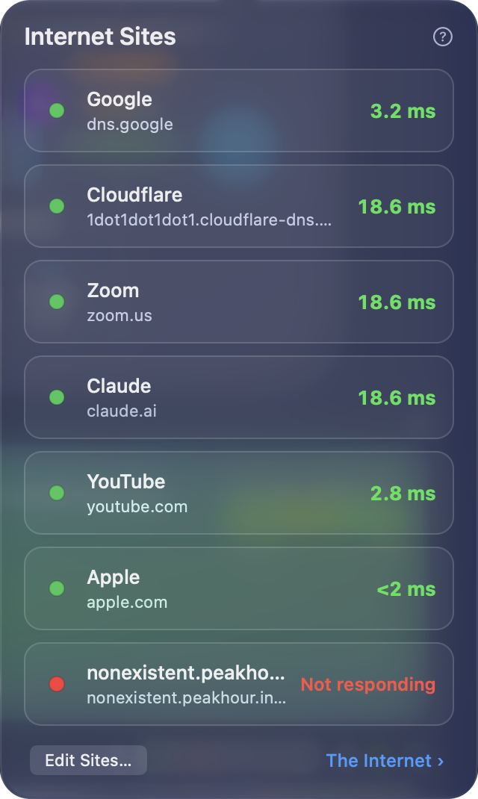
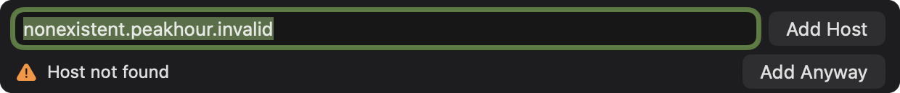
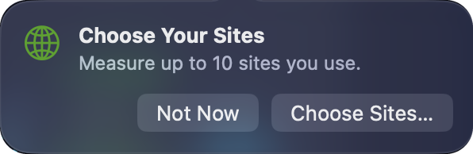

The **Internet** column of the [Internet Dashboard](/user-guide/main-view/internet-dashboard/) gets its status from a list of **Internet sites**. PeakHour pings each site, and combines the results into one latency and one status. The [Internet notification](/user-guide/settings/dashboard/#notifications) and the [PeakHour Advisor](/user-guide/advisor/) use the same rule.

By default, the sites are **Google**, **Cloudflare** and **Netflix**. You can measure up to 10 sites. Choose the sites that you use, so that the status tells you about the Internet that matters to you.

Each site is a [latency monitor](/user-guide/main-view/latency-monitors/). A site that PeakHour adds measures from your ISP to the site, for example **ISP to Google**. Another latency monitor from your ISP to a host can be a site too. See [Use a latency monitor as a site](#use-a-latency-monitor-as-a-site).

## How the sites make the status

### Each site against its own baseline

PeakHour compares each site with its own normal latency: the minimum latency of its monitor. A site far away, for example 120 ms away, is fine at 125 ms. A site 5 ms away is slow at 100 ms.

| Site state | When |
|------------|------|
| **OK** | The latency is near the minimum of the site. |
| **Slow** | The latency is more than 75 ms above the minimum (**Light congestion**). |
| **Slow** | The latency is more than 200 ms above the minimum (**Heavy congestion**). |
| **Not responding** | The site gives no reply: 3 pings in a row get no answer, or no reply comes for 10 seconds. One or two lost pings do not count. The site stays **Not responding** until it replies again, also while its monitor starts again. The first reply brings its latency back at once. |
| **Starting…** | The site has no result yet. It does not count. |

The 75 ms and the 125 ms after it are the [Congestion Thresholds](/user-guide/settings/display/#congestion-thresholds) in Display settings. The minimum of each site comes from its monitor. See [Latency](/user-guide/settings/monitors-settings/latency-monitor/#latency).

### The median latency

The Internet latency is the **median** of the sites that respond. Half of the sites are faster and half are slower. With an even number of sites, it is the average of the two middle sites. So one slow site, or one site far away, does not change the Internet latency much.

The jitter and the packet loss of the Internet are the median of the sites too.

### When the Internet is down

The Internet is **unavailable** when **more than half** of the sites do not respond:

| Sites | Not responding for "unavailable" |
|-------|----------------------------------|
| 1 | 1 |
| 2 | 2 |
| 3 | 2 |
| 4 | 3 |
| 5 | 3 |
| 10 | 6 |

When half of the sites or fewer do not respond, the Internet is still up. The status names the site, for example **Netflix not responding**, or gives a count, for example **2 sites not responding**. The problem is then on the route to that site, or at the site itself.

When most of the sites fail but some still respond, the status reads, for example, **2 of 3 not responding**.

When every site responds, the Internet shows **Light congestion** or **Heavy congestion** only when most of the sites are slow.

### How PeakHour reaches a site

PeakHour pings each site. When a network blocks pings, the site's monitor uses another method, up to a secure HTTPS request to the site. Any reply counts. See [Probe methods](/user-guide/main-view/latency-monitors/#probe-methods).

## The Internet Sites popover

Click **Internet** at the top of the Internet column, or its latency graph, to open the **Internet Sites** popover.

Each site has one row, in the order of your list:

| Element | Description |
|---------|-------------|
| **Status dot** | The colour of the latency of the site, as in the latency graphs. It is red when the site does not respond. |
| **Name** and **host** | The name of the site, with the host that PeakHour pings under it. |
| **Latency** | The latency of the site now. **Not responding** replaces it when the site gives no reply. |
| **Slow** / **Starting…** | A mark after the host, for a slow site or for a site with no result yet. |

At the bottom of the popover:

- The **Edit Sites…** button opens [Settings → Dashboard → Internet Sites](/user-guide/settings/dashboard/#internet-sites).
- **The Internet ›** opens [The Internet](/user-guide/advisor/the-internet/) page of the PeakHour Advisor, with the route to each site. It needs macOS 26 or later.

The **?** button at the top right opens this page.

## The Internet explanation

Hover over the latency of the Internet column to see an **i**. Click it to open the explanation. Its first line reads, for example, **Median of 3 sites**. Under it, the explanation lists only the sites with a problem, for example **Netflix not responding** or **Zoom: 180 ms**. For all the sites, open the [Internet Sites popover](#the-internet-sites-popover).

## Choose your sites

You choose the sites in four places:

- **Settings.** Add, remove and restore the sites in [Settings → Dashboard → Internet Sites](/user-guide/settings/dashboard/#internet-sites).
- **First Time Setup.** Setup asks what you use the Internet for, and suggests sites. See [Choose your sites](/user-guide/first-time-setup/#3-choose-your-sites).
- **After an upgrade to 6.2.** A card under **Internet** asks you one time to choose your sites. See [The Choose Your Sites card](#the-choose-your-sites-card).
- **Monitors settings.** Make a latency monitor from your ISP to a host an Internet site. See [Use a latency monitor as a site](#use-a-latency-monitor-as-a-site).

### The sites to choose from

The site picker groups more than 50 sites by what you use them for. Click a group at the top of the picker to see only its sites, or click **All**. Type in **Search** to find a site by name.

| Group | Sites |
|-------|-------|
| **Work & Video Calls** | Microsoft 365, Zoom, Slack, GitHub, Microsoft Teams, Google Meet, Webex, Notion, Figma, Salesforce, WhatsApp, LinkedIn |
| **Gaming** | Twitch, Steam, PlayStation Network, Xbox Live, Epic Games, Riot Games, Battle.net, Nintendo |
| **Streaming** | Netflix, YouTube, Disney+, Twitch, Spotify, Apple TV+, Prime Video, HBO Max, Hulu, BBC iPlayer |
| **AI Tools** | Claude, ChatGPT, Gemini, Grok, Microsoft Copilot, Perplexity, Mistral |
| **Cloud & Files** | Amazon AWS, Microsoft Azure, Google Cloud, Microsoft 365, iCloud, Dropbox, Google Drive, Notion |
| **Social** | YouTube, Reddit, X (Twitter), Meta (Facebook), Instagram, TikTok, WhatsApp, LinkedIn |
| **General** | Google, Cloudflare, Quad9, OpenDNS, Akamai, Fastly, Amazon, Apple |

To measure a site that is not in the list, type its host name or IP address in **Host name or address**, and click **Add Host** or press Return. PeakHour checks the host first, which takes a few seconds (**Checking...**). When the host can't be found or doesn't reply, the picker reads **Host not found** or **No reply from this host**. Click **Add Anyway** to add it all the same.

 A site that is already in your list reads **In use**.

:::tip
Keep one site that is always fast and near you, such as **Cloudflare** or **Google**. It shows a problem with your connection clearly, even when a site that you use is slow on its own.
:::

### The Choose Your Sites card

After an upgrade from PeakHour 6.1, a card opens one time under **Internet** on the dashboard: **Choose Your Sites** — *Measure up to 10 sites you use.*

- **Choose Sites…** opens the site picker, with your sites selected. Click **Save** to keep your choice.
- **Not Now** closes the card. Your sites stay as they are.

The card does not come back after you click either button. To change the sites later, use [Settings → Dashboard → Internet Sites](/user-guide/settings/dashboard/#internet-sites).

### Use a latency monitor as a site

A latency monitor that measures from your ISP to a host can be an Internet site, for example a monitor of a game server:

- To add a new site with its own monitor, click **+** in [Settings → Monitors](/user-guide/settings/monitors-settings/), choose **Latency**, then choose the **Internet Site** card. See [Configuration Assistant: Latency](/user-guide/configuration-assistant/configuration-assistant-latency/#internet-site).

- In [Settings → Monitors](/user-guide/settings/monitors-settings/), select the latency monitor and turn on **Internet Site**. The switch shows only for a monitor from your ISP to a host.
- Or right-click the monitor, then choose **Designate as → Internet**.

A monitor from this Mac, or from your router, can't be a site: it would measure your home network too. The list holds up to 10 sites. When it is full, remove a site first. See [Designating a Monitor for the Internet Dashboard](/user-guide/settings/monitors-settings/#designating-a-monitor-for-the-internet-dashboard).

## Notifications

The **Internet becomes unreachable** notification uses the same rule: it needs more than half of the sites to fail. With 3 sites or more, one failing site never sends it. A slow site never sends it. The notification also needs 3 failed checks in a row, over at least 30 seconds. See [Notifications](/user-guide/settings/dashboard/#notifications).
