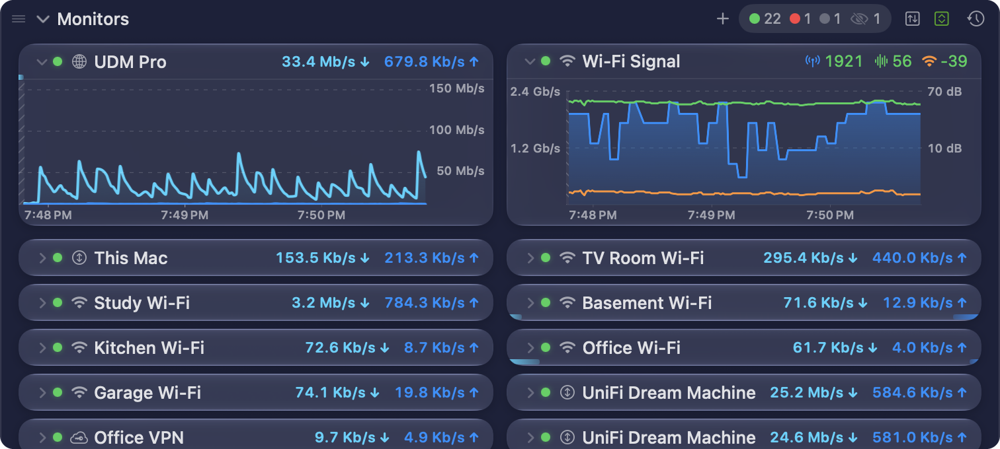
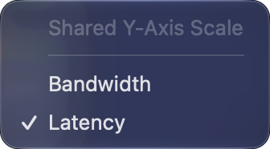

The **Monitors** section of the [main window](/user-guide/main-view/) holds the graphs of all your monitors, of every type:

- [Bandwidth Monitors](/user-guide/main-view/bandwidth-monitors/) — upload and download throughput of a router, a device or an interface.
- [Latency Monitors](/user-guide/main-view/latency-monitors/) — latency, jitter and packet loss to a host.
- [Wi-Fi Signal](/user-guide/main-view/wifi-signal-monitor/) — the Tx rate, the SNR and the signal of this Mac's Wi-Fi.

## Section header

The header bar above the monitors holds the controls for the whole section:

From left to right:

| Control | Description |
|---------|-------------|
| **Grip** (**≡**) and **Monitors** | Drag the header to move the section. Click the title to collapse or expand it. |
| **Add Monitor** (**+**) | Opens [Settings → Monitors](/user-guide/settings/monitors-settings/), with the [Configuration Assistant](/user-guide/configuration-assistant/) at **Choose Monitor Type**. |
| **Counts** | The number of monitors in each status, with a coloured dot: green for **Active**, yellow for **Warning**, red for **Error / Unreachable**, and grey for **Disabled**. An eye with a slash counts the monitors that are hidden, for example because they are disabled or can't be reached. Hover over the counts to see what each one means. |
| **Split View** | Draws download above the middle of each bandwidth graph, and upload below it, each with its own scale. Click it again for the **Stacked View**. It shows only when you have a bandwidth monitor. |
| **Shared Y-Axis Scale** | Opens a menu to put monitors of one unit on the same vertical scale. See [Shared Y-axis scale](#shared-y-axis-scale). |
| **Browse History** | Opens a menu of your monitors. Choose one to open its [History view](/user-guide/history-view/). |

**Split View** and **Shared Y-Axis Scale** show only while the section is expanded.

## Shared Y-axis scale

The menu has one item for each unit in the section:

- **Bandwidth** — puts every bandwidth monitor on one scale, so you can compare throughput directly.
- **Latency** — puts every latency monitor on one scale.

You can turn on one unit, both, or neither. Each unit has its own scale: a latency graph never shares a scale with a bandwidth graph. The button looks active while a unit shares its scale. Both are off by default.

A [Wi-Fi Signal](/user-guide/main-view/wifi-signal-monitor/) monitor always uses its own two scales.

## The order of the monitors

The monitors show in the order of your monitor list. Drag a monitor in the main window to move it. Monitors of different types can mix, for example a latency monitor between two bandwidth monitors.

To add a monitor, click **+** in the header. To remove one, right-click it and choose **Delete…**. See [Monitors settings](/user-guide/settings/monitors-settings/).

:::note
Before PeakHour 6.2, the main window had a **Bandwidth Monitors** section and a **Latency Monitors** section. The Monitors section replaces both. It is expanded when one of the two sections was expanded.
:::
