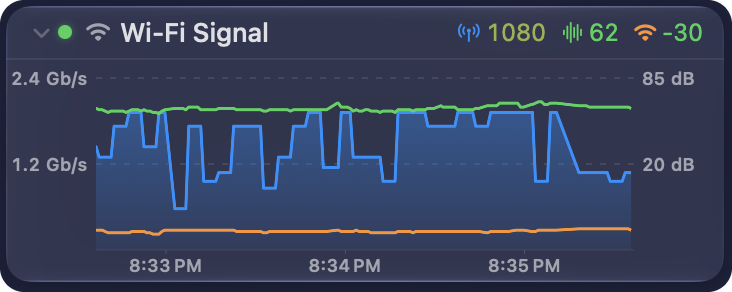
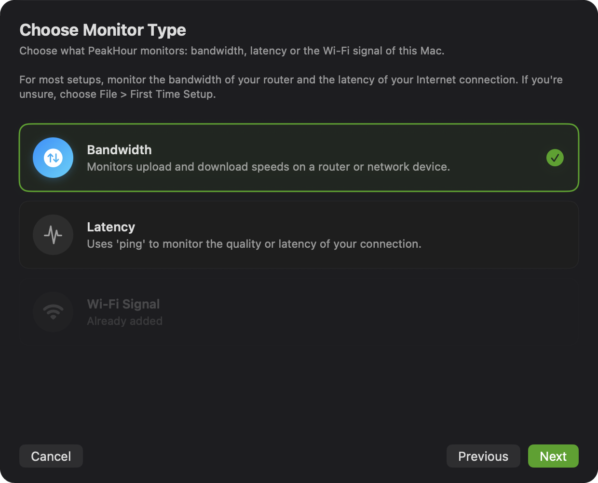
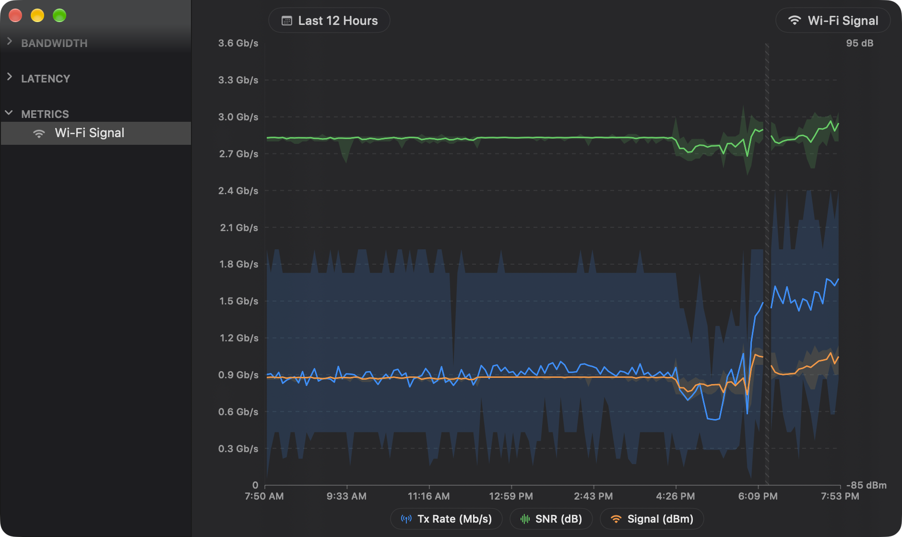

The **Wi-Fi Signal** monitor graphs the quality of this Mac's Wi-Fi link, second by second. It shows three values in one graph:

| Value | Unit | What it shows |
|-------|------|---------------|
| **Tx Rate** | Mb/s | The rate at which your Mac sends data to the access point. This is the speed of the Wi-Fi link, not your Internet speed. |
| **SNR** | dB | The signal-to-noise ratio: how far the signal stands above the noise. Higher is better: above 40 dB is excellent, 15 dB or less is poor. |
| **Signal** | dBm | The strength of the signal from the access point. Values closer to 0 are stronger: −75 dBm or lower is weak. |

Use it to find a weak spot in your home, to see if the Wi-Fi drops, or to check a change to your access point. The [This Mac](/user-guide/main-view/internet-dashboard/#this-mac) card of the dashboard shows the same values now. The monitor keeps them over time.

## Add the monitor

1. Click **+** in the header of the [Monitors](/user-guide/main-view/monitors/) section, or the **+** button in [Settings → Monitors](/user-guide/settings/monitors-settings/).
2. On **Choose Monitor Type**, choose **Wi-Fi Signal**.
3. Click **Next**.

PeakHour adds the monitor at once, with the name **Wi-Fi Signal**. There are no more steps.

A Mac has one Wi-Fi Signal monitor. When you have one already, the card reads **Already added**. A Mac with no Wi-Fi shows no card.

## Reading the graph

- **Tx Rate** is a blue area, on the scale at the left. The scale starts at 0 and goes to the highest rate that your Wi-Fi standard and channel width allow.
- **SNR** (green) and **Signal** (orange) are lines, on the scale at the right. The scale labels only its top and bottom values, in dB or dBm.
- The graph shows the last 3 minutes by default. Use **Zoom In** and **Zoom Out** in the [graph toolbar](/user-guide/main-view/bandwidth-monitors/#graph-toolbar) to show from 30 seconds to 10 minutes. Swipe sideways on the trackpad to look back further.
- Hover over the graph to see the time and each value at that moment.

The summary row above the graph shows the value of each series now, in the colour of its quality. A narrow monitor drops the units first, then shows only the Tx rate.

PeakHour reads the values at each [Refresh Interval](/user-guide/settings/display/#refresh--units), every second by default.

### When the Wi-Fi drops

When your Mac is not on a Wi-Fi network, the monitor reads **Not connected**, and its status light is yellow. The graph marks the time with no Wi-Fi as a red band. Hover over the band to see **Not connected**.

While your Mac sleeps, PeakHour reads no values. After a wake, the time of the sleep shows as a hatched area, not as a red band. Hover over a gap to see **No data**.

## History and CSV export

The Wi-Fi Signal monitor keeps its history, as a bandwidth or latency monitor does. To open it:

- double-click the graph;
- or click **Show History** in the graph toolbar;
- or click **Browse History** in the header of the [Monitors](/user-guide/main-view/monitors/#section-header) section, and choose the monitor.

The History view shows each series as a line, its average, with a light band for its lowest and highest value in each period. Click a series in the legend to hide or show it. A period with no data is hatched. For the controls, see [History View](/user-guide/history-view/#wi-fi-signal-monitors).

To export the history, click **Export** in the History view. The CSV file has a **Date** column, then the average, the minimum and the maximum of each series, for example **Tx Rate Avg (Mb/s)**.

## Settings

Select the monitor in [Settings → Monitors](/user-guide/settings/monitors-settings/) to change:

- its **Name** and its symbol;
- **Enabled** and **Visibility**;
- **Graph View** or **Summary View**, and the **Graph Timespan**.

To remove the monitor, select it and click **-**. This also deletes its history.

## PeakHour Remote

[PeakHour Remote](/user-guide/settings/remote/#monitors) shows the Wi-Fi Signal monitor on its **Monitors** tab, with the value of each series and a graph of the last minute.

:::tip
For what to do about a weak signal, interference or a slow link, see [Improve a weak Wi-Fi signal](/troubleshooting/fix-a-grade/weak-wifi-signal/). To get a notification about these problems, turn on **Wi-Fi issues** in [Settings → Dashboard → Notifications](/user-guide/settings/dashboard/#notifications).
:::
